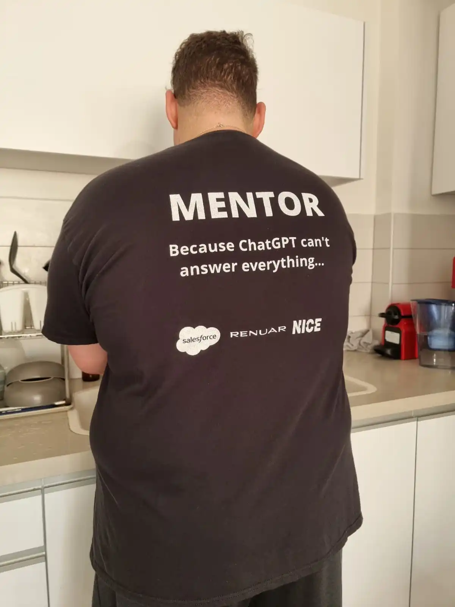

# Hackathon Mentorship
- [What Is a Hackathon?](#what-is-a-hackathon)
- [Personal Experience](#personal-experience)
- [Understand the Event Before You Mentor](#understand-the-event-before-you-mentor)
- [Keeping Participants Focused](#keeping-participants-focused)
  - [Define the Problem](#define-the-problem)
  - [Build an MVP](#build-an-mvp)
  - [Manage Time and Team Roles](#manage-time-and-team-roles)
  - [Prepare for Out-of-Scope Questions](#prepare-for-out-of-scope-questions)
  - [Nail the Presentation](#nail-the-presentation)
- [Be Supportive](#be-supportive)

## What Is a Hackathon?

A hackathon is an intensive event, usually lasting from one day to several days, where individuals or teams collaborate to achieve specific goals.
The organizers set these goals, which can involve software, hardware, or both.

A hackathon does not have to be a competition between teams with a prize at the end.
An organization can also run an internal, single-team hackathon—racing against the clock solely to build a POC (Proof of Concept).

## Personal Experience

I have mentored at multiple hackathons and hope to do more.
Some of the events I have mentored at include:
- Reichman University (Israel)
- Israeli Ministry of Education AI initiative (middle and high school participants)
- SAP AI Bootcamp (internal SAP event)

## Understand the Event Before You Mentor

The organization hosting the event always has a specific goal in mind, such as:
- Generating new product ideas to sell to customers
- Building a rapid POC to validate feasibility for leadership
- Solving a specific technical or business problem
- Recruiting and evaluating new talent
- Testing their tools, APIs, or platforms with real users
- Building brand awareness and a developer community

Before you fully understand the event's goal, you cannot guide participants toward something meaningful.

## Keeping Participants Focused

Many hackathon participants start with overly broad or ambitious solutions that take too long to build or fall outside the event's scope.
As a mentor, your job is to keep them focused.

### Define the Problem
If a team cannot clearly define the problem they are solving, they cannot convince anyone that their solution fits.
Help them narrow it down to a clear problem—not too trivial, not too broad, and aligned with the event's target.

### Build an MVP
An MVP (Minimum Viable Product) is the smallest version of the product that proves the idea works.
Extra features can always come later; they are irrelevant during a hackathon.

Once the problem is clear, help the team decide what must be real code and what should be mocked:
- **Mock integrations:** If the solution integrates with external systems, prove the flow works using mocked data, real data is great, but it is often unreliable under time pressure, focus on a working happy path for the demo.
- **Apply the demo rule:** If a feature will not be visible in the final presentation, cut it.
- **Guide, don't build:** Do not be shy about pointing out flaws, but do not be overly demanding either, give your honest opinion and steer the team back to the problem, the MVP, and the organizer's goal—without handing them the final solution.
- **Suggest tools and libraries:** If you have a helpful suggestion that can speed up their MVP, point them to it and let them research whether it actually fits their needs.

> [!TIP]
> A mentor's role is to ask the right questions and provide direction, not to write the code or design the solution for the team.

### Manage Time and Team Roles
Time disappears quickly in a hackathon, encourage teams to set two simple habits early on:
- **Split roles early:** Divide work across engineering, UI/UX, and research/pitching so teammates do not bottleneck on the same task.
- **Set checkpoints:** Aim to have the core happy path working well before the deadline, and reserve the final hours strictly for recording the demo and rehearsing the pitch.

### Prepare for Out-of-Scope Questions
Help teams prepare for uncertainty, during Q&A, judges and attendees may ask unexpected questions—about security, feature requests, or why the team chose approach A over approach B.

As a mentor, ask anything that comes to mind, even simple questions.
Practicing these curveballs helps participants explain their decisions clearly and calmly.
This is a skill you will sharpen with every event you mentor.

### Nail the Presentation
The presentation is the most important part.
No matter how strong the problem and solution are, poor delivery makes them meaningless.

Presenters usually get only 4 to 10 minutes to show their work, coach them on the following:
- **Speak clearly and professionally:** Use a calm, confident tone—neither too casual nor overly academic, clearly explain the problem, the solution, and why they fit together.
- **Know your audience:** Judges are often non-technical, and in internal POC hackathons they are leadership or stakeholders deciding whether the idea is worth investing in, deep dives into code or hardware rarely win them over, instead, highlight business impact: how much money it will earn, how much money or time the solution saves, and back it up with real-world data or percentages where possible without exaggerating.
- **Embrace existing competitors:** If a similar solution already exists, that is great news—it proves market demand, help the team articulate why theirs is better (cost, features, reliability) and lean into that strength.
- **Prefer a recorded demo over slides:** Judges want to see the product work, not read walls of text, aim for at most 2 slides plus a recorded demo, unless a live demo is required or guaranteed to work reliably, a recording provides a fixed point in time where everything worked and removes unnecessary risk.
- **Run a timed rehearsal:** Have the team do at least one full, timed dry run before going on stage to fix pacing and unclear transitions.

## Be Supportive

If possible, be in the room when the team presents.
Seeing a familiar face in the audience helps calm their nerves.
Even if the pitch goes poorly, keep a warm, supportive smile—it goes a long way.

If you cannot be there for the presentation, take a minute to talk to the presenters beforehand to calm them down and boost their confidence before they go on stage.
